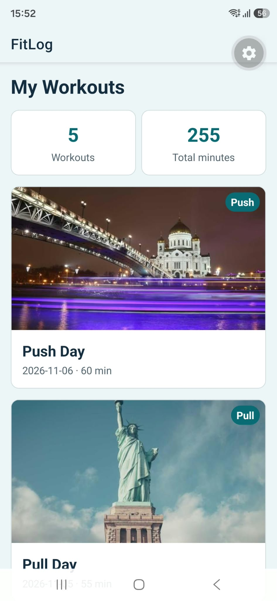
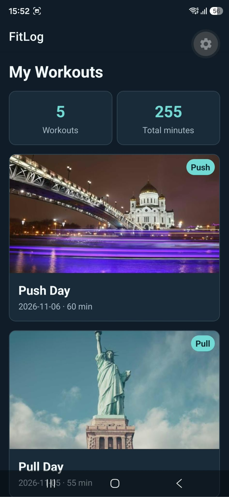

# FitLog

FitLog is a personal workout journal for people who want to keep their gym sessions organised. Users will be able to create, view, edit and delete workouts with exercises, duration, notes and an optional photo.

## Run locally

```bash
npm install
npx expo start
```

Scan the QR code with Expo Go compatible with SDK 58.

## Features

- [x] Workout list with five sample workouts
- [x] Reusable workout cards and details component
- [ ] Navigation from the list to workout details
- [ ] Add, edit and delete workouts
- [ ] Search and category filters
- [ ] Workout photos from the phone gallery
- [ ] Supabase sign-in and private workout storage
- [x] Light and dark themes

## Lab 5 screenshots



